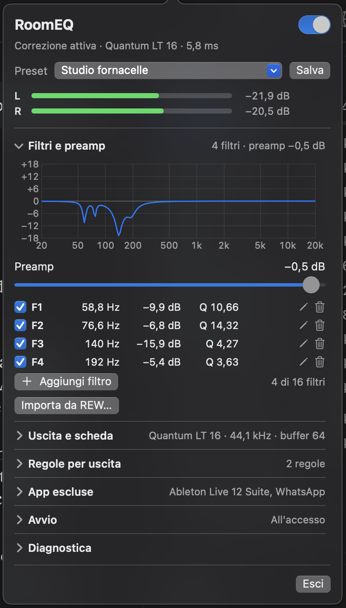

# RoomEQ

Un'app per la barra dei menu di macOS che applica una correzione della stanza (un equalizzatore parametrico) a tutto l'audio del Mac, tranne le app che escludi.

*Guida in italiano: questa pagina è la traduzione di [README.md](README.md) e [docs/USER_GUIDE.md](docs/USER_GUIDE.md). Per chi sviluppa: [architettura](docs/ARCHITECTURE.md) (in inglese) e [come contribuire](CONTRIBUTING.md) (in inglese).*

<p align="center"></p>

RoomEQ è pensato per chi misura la propria stanza d'ascolto con [REW](https://www.roomeqwizard.com) (Room EQ Wizard) e vuole applicare i filtri di correzione calcolati a tutto il Mac, senza passare da un dispositivo audio virtuale o da un driver di terze parti. L'app cattura l'uscita di sistema con un «process tap» di Core Audio, la fa passare da un equalizzatore parametrico e la riproduce sulla stessa scheda audio. Le app che fanno già una correzione per conto loro, per esempio un DAW con un EQ sul master, si possono escludere, così il loro audio non viene corretto due volte.

## Indice

- [Caratteristiche](#caratteristiche)
- [Requisiti](#requisiti)
- [Compilare e installare](#compilare-e-installare)
- [Avvio rapido](#avvio-rapido)
- [Come funziona, in un paragrafo](#come-funziona-in-un-paragrafo)
- [L'icona nella barra dei menu](#licona-nella-barra-dei-menu)
- [Il pannello](#il-pannello)
- [Importare i filtri da REW](#importare-i-filtri-da-rew)
- [Verificare che i filtri siano giusti](#verificare-che-i-filtri-siano-giusti)
- [Verificare un EQ nel DAW](#verificare-un-eq-nel-daw)
- [Se qualcosa non va](#se-qualcosa-non-va)
- [Aggiornare o disinstallare](#aggiornare-o-disinstallare)
- [Limiti e cose che RoomEQ non fa](#limiti-e-cose-che-roomeq-non-fa)
- [Privacy](#privacy)
- [Documentazione e licenza](#documentazione-e-licenza)

## Caratteristiche

- **Nessuna conversione della frequenza di campionamento.** L'audio viene elaborato alla frequenza della scheda audio. Se le frequenze non coincidono, RoomEQ non parte, invece di ricampionare.
- **Qualsiasi uscita.** Schede audio USB o Thunderbolt, altoparlanti integrati, cuffie. Sulle schede con almeno 4 canali d'uscita scegli quale coppia stereo usare.
- **Esclusione per app.** Le app escluse non passano dalla correzione: il loro audio va diretto all'uscita. Per un utente nuovo non è esclusa nessuna app: aggiungi il tuo DAW, o qualsiasi app che fa già una correzione per conto suo, in **App escluse**.
- **Regole per uscita.** Per ogni uscita scegli **Preset attuale**, un preset preciso oppure **Nessuna correzione**. Con «Nessuna correzione» RoomEQ si fa da parte del tutto: l'audio va diretto alla scheda, senza latenza aggiunta. Le regole si applicano da sole quando cambia l'uscita di macOS.
- **Preset.** Salva, rinomina, duplica ed elimina insiemi di filtri con il loro preamp, ognuno con un nome.
- **Importazione da REW.** Carica il file di testo esportato da REW (Export filter settings as text, equalizzatore Generic).
- **Bassa latenza.** Il valore mostrato nella riga di stato è la latenza **totale** d'uscita, stimata dall'app. Comprende la latenza propria della scheda audio, che c'è anche senza RoomEQ. Sulla scheda dell'autore è circa 6 ms con un buffer di 64 frame. Il tuo risultato dipende dalla tua scheda e dal buffer; il pannello mostra la stima per la tua.
- **Sicurezza in caso di guasto.** Se RoomEQ si chiude o va in crash, l'audio delle app torna normale da solo: le app sono silenziate solo finché RoomEQ è in funzione (verificato chiudendo RoomEQ di forza con `kill -9` durante la riproduzione).
- **Italiano e inglese.** L'interfaccia segue la lingua di macOS.

## Requisiti

- macOS 15 (Sequoia) o successivo per usare l'app.
- Per compilarla: Xcode 26 o successivo (toolchain Swift 6.2 o successiva). Il codice usa API dell'SDK di macOS 26 (`CATapDescription.bundleIDs` e `isProcessRestoreEnabled`), protette da un controllo a runtime: l'app gira anche su macOS 15, ma per compilarla serve l'SDK di macOS 26. Il progetto si compila con Swift Package Manager; non c'è un progetto Xcode.
- Il permesso **Registrazione schermo e audio di sistema**. macOS lo chiede la prima volta che RoomEQ avvia la correzione (Impostazioni di Sistema › Privacy e sicurezza › Registrazione schermo e audio di sistema). macOS può mostrare anche la richiesta per il microfono, perché le schede audio hanno degli ingressi: RoomEQ non registra il microfono e usa la scheda solo come uscita.

## Compilare e installare

Non ci sono programmi già compilati: si compila dai sorgenti, da Terminale, nella cartella del progetto.

```bash
./build.sh        # compila, controlla le traduzioni, assembla e firma build/RoomEQ.app
./run-tests.sh    # test automatici (non servono schede audio né permessi)
./install.sh      # copia build/RoomEQ.app in /Applications
open /Applications/RoomEQ.app
```

Puoi anche aprire `build/RoomEQ.app` senza installarla. «Apri all'accesso» funziona meglio con l'app in `/Applications`.

**La firma.** `build.sh` firma l'app «ad hoc» (`codesign --sign -`), quindi non serve un account sviluppatore Apple. Conseguenze:

- macOS lega i permessi di privacy alla firma e alla posizione dell'app, quindi può chiedere di nuovo il permesso audio dopo ogni ricompilazione o reinstallazione.
- L'app non è notarizzata. Un'app compilata sul tuo Mac si apre normalmente; se invece copi l'app su un altro Mac con un download o con AirDrop, Gatekeeper la bloccherà quasi certamente e dovrai consentirla a mano.

## Avvio rapido

1. In REW apri la finestra **EQ**, scegli l'equalizzatore **Generic** e poi **Export filter settings as text**.
2. Clicca l'icona di RoomEQ nella barra dei menu, apri **Filtri e preamp**, clicca **Importa da REW…** e scegli il file.
3. Se RoomEQ dice «La curva amplifica fino a …», clicca **Applica** per impostare il preamp consigliato ed evitare la saturazione. Fallo prima di salvare, perché il preamp fa parte del preset.
4. Clicca **Salva** per tenere filtri e preamp nel preset attuale (oppure **Salva come…** dal menu Preset per dargli un nome).
5. Accendi l'interruttore **Correzione** in alto.
6. Se usi un DAW (o un'altra app) che applica già una sua correzione, aggiungilo in **App escluse**, così non viene corretto due volte.

Al primo avvio RoomEQ non ha filtri, ha un solo preset vuoto chiamato «Senza nome», nessuna app esclusa e l'interruttore **Correzione** spento: non cambia nulla finché non importi i tuoi filtri e accendi l'interruttore. Se lo accendi senza filtri, l'audio passa senza modifiche.

## Come funziona, in un paragrafo

RoomEQ chiede a Core Audio un «process tap» sull'uscita attuale di macOS. Il tap cattura l'audio di tutte le app tranne quelle escluse (e RoomEQ stesso) e le silenzia sulla scheda finché RoomEQ sta leggendo. RoomEQ fa passare l'audio catturato dall'equalizzatore e riproduce il risultato sulla stessa scheda. Non c'è nessun dispositivo audio virtuale e nessuna conversione della frequenza di campionamento. Se RoomEQ si chiude o va in crash, il tap sparisce e le app tornano a suonare direttamente sulla scheda, senza che RoomEQ debba fare nulla.

## L'icona nella barra dei menu

Clicca l'icona nella barra dei menu per aprire il pannello: è un fumetto con la punta sotto l'icona. Si chiude con un altro clic sull'icona, oppure cliccando fuori dal pannello.

| Icona | Significato |
|---|---|
| Cursori dell'equalizzatore ad altezze diverse | La correzione è applicata. |
| Cursori allineati e barrati | La correzione **non** è applicata: è spenta, oppure in pausa per questa uscita a causa di una regola per uscita. |
| Tre puntini | Si sta avviando, o aspetta che la scheda audio sia pronta. All'avvio, alla ripresa e dopo un cambio dell'uscita di macOS RoomEQ continua a provare per circa 30 secondi, perché una scheda appena accesa o collegata spesso non è subito pronta. |
| Punto esclamativo | Errore. Apri il pannello e leggi il messaggio. |

## Il pannello

### In alto

- Interruttore **Correzione**. È l'unico comando di accensione e spegnimento. Quando è spento non gira nulla e l'audio va diretto all'uscita, senza latenza aggiunta. RoomEQ ricorda la posizione dell'interruttore da un avvio all'altro. Al primo avvio è spento e non ci sono ancora filtri: importali da REW, poi accendilo.
- **Riga di stato** sotto l'interruttore, per esempio «Correzione attiva · *nome della scheda* · 6,3 ms» (l'uscita e la latenza totale d'uscita stimata). Il numero è il totale: comprende la latenza propria della scheda audio, che c'è anche senza RoomEQ, quindi non è tutta aggiunta da RoomEQ. **Diagnostica** mostra la suddivisione.
- Menu **Preset**, descritto sotto.
- **Livelli**: i misuratori del canale sinistro e destro dell'uscita. Il badge **CLIP** compare quando un picco ha superato 0 dB. Sotto il badge il pannello spiega il motivo: o è la correzione stessa a portare il segnale sopra 0 dB (con un pulsante che imposta un preamp più basso), oppure il segnale arriva già oltre 0 dB dall'app. Clic sul badge per azzerarlo.

### In basso

- **Esci** toglie del tutto RoomEQ dal Mac, e l'audio torna normale.

### Preset

Un preset è un insieme di filtri con nome, più il valore del preamp.

- Il menu **Preset** elenca i tuoi preset e le azioni **Salva come…**, **Rinomina…**, **Duplica** ed **Elimina…**.
- Un pallino arancione (●) accanto al nome del preset vuol dire che ci sono modifiche non salvate: accanto al menu compare allora il pulsante **Salva**. Se cambi preset con modifiche non salvate, RoomEQ ti chiede cosa farne.
- I nomi dei preset possono avere al massimo 40 caratteri e devono essere diversi tra loro. Non si può eliminare l'ultimo preset rimasto.
- Al primo avvio c'è un solo preset vuoto, «Senza nome». Dopo la prima importazione, **Salva** ci memorizza i filtri; se vuoi, rinominalo dal menu Preset.

### Le sezioni

Sono tutte chiuse all'inizio. Clic sul titolo per aprirle; a destra di ogni titolo c'è un breve riassunto, visibile anche da chiusa (tutte le sezioni tranne Diagnostica). RoomEQ ricorda quali sezioni hai aperto.

**Filtri e preamp**

- Il grafico della curva di correzione e l'elenco dei filtri. Ogni filtro ha una frequenza, un guadagno e un Q, e si può spegnere, modificare o eliminare. **Aggiungi filtro** ne aggiunge uno neutro (1 kHz, 0 dB, Q 1).
- Limiti: fino a 16 filtri, tutti parametrici a campana (peaking); frequenza da 10 Hz a 20 kHz (e non oltre 0,45 volte la frequenza di campionamento); guadagno da −30 a +30 dB; Q da 0,1 a 100. Un filtro fuori da questi limiti resta nell'elenco ma non viene applicato, con un avviso.
- **Preamp**: da −24 dB a 0 dB. Può solo attenuare, mai amplificare. Se la curva amplifica in qualche punto, RoomEQ mostra «La curva amplifica fino a …: preamp consigliato …» con il pulsante **Applica**. Usalo per evitare la saturazione.
- **Importa da REW…**: vedi [Importare i filtri da REW](#importare-i-filtri-da-rew).

**Uscita e scheda**

- **Uscita audio**: l'uscita di macOS. Sceglierne una qui cambia l'uscita predefinita di macOS, e RoomEQ la segue.
- **Canali**: quale coppia di canali d'uscita usare (1–2, 3–4, …). Compare solo sulle schede con almeno 4 canali d'uscita.
- **Frequenza di campionamento**: le frequenze offerte dalla scheda. È un'impostazione della scheda stessa, quindi vale per tutte le app che la usano, comprese quelle escluse, non solo per RoomEQ. Per questo RoomEQ chiede conferma, e si riavvia per un istante se la correzione è in funzione. Se un DAW è aperto e sta suonando, cambia la frequenza con il DAW chiuso o fermo.
- **Buffer**: la dimensione del buffer di I/O in frame (64, 128 o 256, nei limiti di ciò che la scheda accetta). Un buffer più piccolo dà meno latenza. L'impostazione predefinita è 64; se senti dei crepitii, scegli 128.

**Regole per uscita**

Le regole sono sempre attive. Per ogni uscita che RoomEQ ha incontrato scegli:

- **Preset attuale**: nessuna regola. Il suono resta com'è, corretto con il preset in uso in quel momento.
- **un preset**: quando questa uscita diventa l'uscita di macOS, RoomEQ passa automaticamente a quel preset (per esempio un preset per i monitor da studio e un altro per le cuffie).
- **Nessuna correzione**: RoomEQ si fa da parte. L'audio va diretto alla scheda, senza latenza aggiunta, e la riga di stato dice che la correzione è in pausa per questa uscita. Va bene per le uscite che non hanno bisogno di correzione, come gli altoparlanti integrati. Quando torni a un'uscita corretta, RoomEQ riparte da solo.

Le modifiche non salvate fatte su un'uscita vengono ricordate per quell'uscita («modifiche non salvate ricordate») se un cambio automatico di preset le sostituisce. Le regole sono legate all'UID Core Audio della scheda; una scheda che cambia UID (alcune schede USB lo fanno se le sposti su un'altra porta) appare come una nuova uscita.

**App escluse**

Le app in questo elenco non vengono catturate: il loro audio non passa da RoomEQ. All'inizio l'elenco è vuoto, quindi non è esclusa nessuna app finché non ne aggiungi una. Se usi un DAW o un'altra app che applica già una sua correzione, aggiungila qui, altrimenti il suo audio verrà corretto due volte. Usa **Aggiungi app…** per scegliere tra le app aperte in quel momento (quelle che stanno suonando sono segnalate) oppure **Scegli dalle Applicazioni…** per sceglierne una qualsiasi. L'esclusione funziona in base all'identificativo (bundle identifier) dell'app e include i suoi processi ausiliari.

- RoomEQ è sempre escluso in automatico e non compare mai nell'elenco.
- **Non escludere REW** se vuoi misurare il suono corretto: i suoi sweep devono passare da RoomEQ. RoomEQ ti avvisa se lo escludi.

**Avvio**

**Apri all'accesso** fa partire RoomEQ quando accedi al Mac. Se la correzione era accesa, riparte accesa. Funziona meglio con l'app in `/Applications`. Se macOS richiede la tua approvazione, un pulsante apre Elementi login ed estensioni in Impostazioni di Sistema.

**Diagnostica**

Numeri tecnici: latenza stimata e sua suddivisione, formato del tap, ritardo dell'anello, underrun, contatori di clip, sovraccarichi e picchi in ingresso e in uscita. Serve solo per capire un problema.

## Importare i filtri da REW

1. In REW apri la finestra **EQ** e scegli l'equalizzatore **Generic**. Altri modelli di equalizzatore potrebbero definire i filtri in modo diverso.
2. Scegli **Export filter settings as text**.
3. In RoomEQ apri **Filtri e preamp**, clicca **Importa da REW…** e scegli il file.
4. RoomEQ chiede conferma se l'importazione sostituirebbe modifiche non salvate. I filtri importati sostituiscono quelli attuali.
5. Controlla gli eventuali avvisi (filtri saltati, tipi non supportati e così via).
6. Se compare «La curva amplifica fino a …», clicca **Applica** per impostare il preamp consigliato.
7. Clicca **Salva** o **Salva come…** per tenere il risultato come preset. Fallo dopo il passo precedente, perché il preamp fa parte del preset.

Cosa fa l'importazione:

- Legge i filtri parametrici a campana (`PK`). I filtri impostati su `None` vengono ignorati. I filtri `OFF` vengono importati come disattivati.
- Salta gli altri tipi (shelf, passa-basso e passa-alto e così via), con un avviso.
- Se il file ha più di 16 filtri PK, ne importa 16: i primi 16 attivi, nell'ordine del file, e, se gli attivi sono meno di 16, completa i posti rimasti con quelli disattivati. Ti avvisa dei filtri lasciati fuori.
- Accetta sia la virgola sia il punto decimale, e le frequenze in kHz.
- Rifiuta i file più grandi di 1 MB o che non sono di testo, e lascia invariati i filtri attuali se non trova nessun filtro utilizzabile.

RoomEQ parte dal presupposto che l'equalizzatore Generic di REW definisca il Q come i filtri di RoomEQ (il filtro a campana standard del «cookbook» RBJ). L'autore lo ha verificato il 1° novembre 2026 con una misura in loopback (vedi la sezione successiva): le due risposte coincidono entro circa 0,05 dB.

Ogni volta che fai una nuova misura in REW e calcoli nuovi filtri, ripeti questi passi. Se un DAW con un suo EQ è escluso da RoomEQ e vuoi la stessa correzione anche lì, inserisci a mano gli stessi filtri in quell'EQ.

## Verificare che i filtri siano giusti

Puoi verificare tutta la catena con una misura che non richiede il microfono, registrando l'uscita della scheda audio attraverso un loopback interno. Molte schede audio ne hanno uno: una coppia di ingressi che porta una copia di un'uscita scelta. Se la tua non ne ha, un cavo fisico da un'uscita a un ingresso fa lo stesso lavoro.

Il metodo, in generale:

1. Imposta un loopback in modo che l'audio che macOS manda alla scheda (le uscite su cui suona RoomEQ) compaia anche su due ingressi liberi della scheda.
2. In REW scegli come ingresso della misura quel loopback, scegli l'uscita corrispondente e imposta il riferimento temporale (timing reference) su **none**. Abbassa il volume delle casse: lo sweep non deve per forza essere ascoltato.
3. Spegni la **Correzione** di RoomEQ e misura. Chiama la misura «OFF». È il suono diretto e deve risultare piatto.
4. Accendi la correzione e misura di nuovo. Chiama la misura «ON».
5. In REW apri **All SPL**, poi **Actions › Trace arithmetic**. Imposta A = «ON» e B = «OFF», scegli **A / B** (non «A − B») e clicca **Generate**.

Il risultato è la risposta del solo RoomEQ. Deve coincidere con la curva dei filtri importati. L'autore accetta un margine di 0,2–0,3 dB; il suo controllo sui propri filtri ha dato un accordo entro 0,1 dB. Con lo stesso tipo di misura l'autore ha confermato la definizione di Q citata nella sezione precedente.

### Esempio: PreSonus Quantum con Universal Control

L'autore usa una PreSonus Quantum LT 16, il cui loopback interno è sugli ingressi 17–18. Preparazione, da fare una volta sola, in Universal Control:

1. **Ingranaggio** › **Appearance**, poi attiva **Show All Loopback**.
2. Sul canale che riceve l'audio del Mac (uscite 1–2), alza il **Loopback send** a 0 dB.
3. Abbassa del tutto il Loopback send degli altri canali.

Poi in REW usa l'ingresso **canale 17** e l'uscita **canale 1**, con riferimento temporale **none**, e segui i passi qui sopra. Le altre schede hanno impostazioni di loopback diverse: controlla il manuale della tua.

### Misura con il microfono (facoltativa)

Una misura con il microfono mostra l'effetto della correzione nella stanza; non serve a controllare RoomEQ.

- Tieni il microfono fermo nel punto d'ascolto.
- Fai una misura con la **Correzione** spenta e una con la correzione accesa.
- Usa il riferimento temporale **acoustic** o **none**, mai quello via loopback: REW lo manderebbe all'altra cassa.

## Verificare un EQ nel DAW

Se hai escluso un DAW da RoomEQ e hai rifatto gli stessi filtri al suo interno, puoi controllare quell'EQ allo stesso modo. Il DAW è escluso, quindi lo sweep di prova lo deve suonare lui.

1. In REW apri **Generator**, scegli **Measurement Sweep** alla frequenza di campionamento che usi, con un riferimento temporale, e salvalo come file WAV.
2. Nel DAW metti il WAV su una traccia audio con il warp spento. Porta traccia e master a 0 dB. Sul master tieni solo l'EQ che stai controllando: spegni limiter e altri effetti.
3. In REW misura con il file: carica lo stesso WAV, scegli l'ingresso di loopback e usa il riferimento temporale **acoustic**.
4. Avvia la misura in REW. Quando compare «Waiting for timing reference…», premi play nel DAW.
5. Fai una misura con l'EQ spento e una con l'EQ acceso, poi dividile (**A / B**) come sopra.

### Esempio: Ableton Live ed EQ Eight

Ableton Live è un caso tipico di DAW con una correzione propria: un EQ Eight sul master con gli stessi filtri, e Ableton aggiunto a **App escluse** per non essere corretto due volte. EQ Eight è l'equalizzatore incluso in Ableton Live. Le sue bande non scendono sotto **−15 dB**, e non c'è nessun avviso se scrivi un valore più basso. Se un filtro è più profondo, per esempio −15,9 dB, usa due bande con la **stessa frequenza e lo stesso Q**: una a −15 dB e una con il resto (−0,9 dB). Le due bande in cascata sommano esattamente il taglio solo alla frequenza centrale; altrove la somma è un'approssimazione. Usa il tipo campana (bell) per ogni banda.

## Se qualcosa non va

| Problema | Cosa fare |
|---|---|
| Nessun suono con RoomEQ acceso | Spegni l'interruttore **Correzione**. Se il suono torna, apri Impostazioni di Sistema › Privacy e sicurezza › **Registrazione schermo e audio di sistema** e controlla che RoomEQ sia consentito. |
| Nessun suono anche dopo aver chiuso RoomEQ | Riavvia il Mac. |
| Crepitii o interruzioni | In **Uscita e scheda** imposta **Buffer** a 128 o 256. |
| Un messaggio d'errore in rosso | Leggilo: dice cosa è successo. Se l'audio non può passare da RoomEQ, RoomEQ lo lascia andare diretto all'uscita, senza correzione, e l'interruttore resta acceso. I tentativi automatici avvengono solo nella finestra di circa 30 secondi dopo l'avvio, la ripresa o un cambio d'uscita (icona a tre puntini): quando compare l'errore in rosso, quei tentativi sono finiti. Premi **Riprova**, oppure cambia l'uscita di macOS: RoomEQ riparte da solo. Un errore grave mentre RoomEQ è in funzione va subito all'errore in rosso, senza tentativi. |
| «La correzione supera 0 dB» o il badge CLIP | La correzione amplifica il segnale. Clicca il pulsante **Preamp a …** sotto i misuratori, oppure usa **Applica** in **Filtri e preamp**. Se il messaggio dice che il segnale arriva già oltre 0 dB dall'app, la causa è l'app, non RoomEQ. |
| Un DAW (o un'altra app esclusa) viene corretto | Controlla che sia in **App escluse**. |
| Il permesso audio viene richiesto di nuovo | Può succedere dopo che ricompili o reinstalli l'app, perché la firma è «ad hoc» e macOS lega il permesso alla firma. Consentilo di nuovo. |
| La latenza sembra più alta del previsto | Apri **Diagnostica** per vedere la stima e la sua suddivisione. Ricorda che il valore comprende la latenza propria della scheda, che c'è anche senza RoomEQ. Usa un buffer più piccolo, oppure dai all'uscita **Nessuna correzione** in **Regole per uscita** se lì non ti serve l'EQ. |
| RoomEQ non parte su una scheda | Le frequenze del tap e della scheda devono coincidere, perché RoomEQ non le converte mai. Controlla la **Frequenza di campionamento** in **Uscita e scheda**. Il messaggio d'errore dice il motivo preciso. |
| Le impostazioni sono state azzerate | Se le impostazioni salvate non sono leggibili, RoomEQ ne conserva una copia di riserva, carica quello che riesce e mostra un avviso. |

## Aggiornare o disinstallare

Per aggiornare, scarica i nuovi sorgenti ed esegui, nella cartella del progetto:

```bash
./build.sh && ./run-tests.sh && ./install.sh
```

Per disinstallare:

1. In RoomEQ apri **Avvio**, spegni **Apri all'accesso**, poi esci da RoomEQ.
2. Elimina `/Applications/RoomEQ.app`.
3. Per cancellare anche le impostazioni salvate: `defaults delete com.federicociapi.RoomEQ`. (Se per una tua copia del progetto hai cambiato il bundle identifier in `Resources/Info.plist`, usa il tuo identificativo in questo e negli altri comandi `defaults`.)

## Limiti e cose che RoomEQ non fa

- Solo stereo. RoomEQ corregge due canali e li scrive su una coppia di canali d'uscita; non gestisce surround né uscite multicanale.
- Solo filtri parametrici a campana (PK), fino a 16. Gli altri tipi di filtro di REW (shelf, passa-basso e passa-alto) vengono saltati all'importazione, con un avviso.
- RoomEQ segue l'uscita predefinita di macOS. Viene corretta solo quell'uscita.
- Nessuna conversione della frequenza di campionamento, per scelta. Cambiare la frequenza in RoomEQ la cambia per tutte le app che usano quella scheda.
- Non è uno strumento di misura né un calcolatore di correzione della stanza: i filtri li calcoli in REW (o con qualsiasi strumento che esporti testo nello stile di REW) e RoomEQ li applica.
- Nessuna versione già compilata, notarizzata o sull'App Store.
- L'importazione da REW presuppone che l'equalizzatore Generic di REW definisca il Q come i filtri di RoomEQ (il filtro a campana standard del «cookbook»). L'autore lo ha verificato il 1° novembre 2026 con una misura in loopback: le due risposte coincidono entro circa 0,05 dB. Puoi ripetere la verifica sul tuo impianto, vedi [Verificare che i filtri siano giusti](#verificare-che-i-filtri-siano-giusti).

## Privacy

L'audio non lascia mai il tuo Mac. RoomEQ non fa nessuna connessione di rete: il codice sorgente non contiene codice di rete, e non registra l'audio su disco. Le impostazioni (filtri, preset, regole, app escluse) sono salvate in locale nelle preferenze dell'app (`defaults read com.federicociapi.RoomEQ`). Se per una tua copia del progetto cambi il bundle identifier in `Resources/Info.plist`, usa il tuo identificativo in questo e negli altri comandi `defaults`. I messaggi diagnostici vanno solo nel registro di sistema di macOS sul tuo Mac (li puoi leggere in Console) e comprendono i nomi delle tue schede audio e gli identificativi (bundle identifier) delle app in esecuzione.

## Documentazione e licenza

- [README](README.md) e [guida utente](docs/USER_GUIDE.md), in inglese: le versioni originali di questa pagina.
- [Architettura](docs/ARCHITECTURE.md), in inglese: come funziona il codice, per chi vuole capirlo o modificarlo.
- [Come contribuire](CONTRIBUTING.md), in inglese.
- RoomEQ è distribuito con licenza GNU GPL 3.0: vedi [LICENSE](LICENSE).
