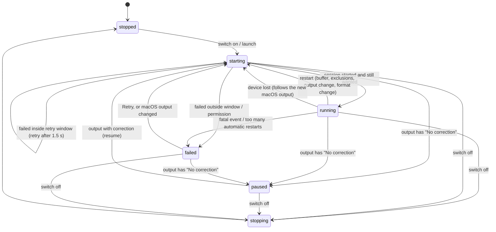

# RoomEQ Architecture

This document is for developers who want to understand or change RoomEQ. It
describes what the code does and, where the code explains it, why. When a
choice is not explained in the code, this document only describes it.

Paths are relative to the repository root. Identifiers in `code` can be
searched for directly.

## Contents

1. [Overview](#1-overview)
2. [Repository layout](#2-repository-layout)
3. [Audio path](#3-audio-path)
4. [DSP](#4-dsp)
5. [Latency](#5-latency)
6. [Controller and states](#6-controller-and-states)
7. [Threads and concurrency](#7-threads-and-concurrency)
8. [Settings](#8-settings)
9. [User interface](#9-user-interface)
10. [Localization](#10-localization)
11. [Build, packaging, permissions](#11-build-packaging-permissions)
12. [Tests](#12-tests)
13. [Diagnostics, hidden defaults, known limitations](#13-diagnostics-hidden-defaults-known-limitations)

---

## 1. Overview

RoomEQ is a menu-bar-only macOS app (`LSUIElement`). It applies a parametric
room-correction EQ (up to 16 RBJ peaking filters plus an attenuating preamp)
to all system audio. Apps on an exclusion list are not processed. The list
is empty by default (the user adds a DAW or any other app that does its own
correction), and RoomEQ itself is always excluded.

How it works, briefly:

- A Core Audio **process tap** on the macOS default output device captures
  what every non-excluded app sends to that device. While RoomEQ reads the
  tap, those apps are muted at the device.
- RoomEQ filters the captured stereo signal and plays it on **the same
  device** through its own IOProc.
- There is **never any sample-rate conversion**. If the rates do not match
  exactly, RoomEQ refuses to run.
- If RoomEQ cannot deliver audio (stall, persistent underruns, clock drift,
  lost device), it **releases the tap promptly**. The apps are then heard
  directly again instead of staying muted.
- The design also aims at a safe result when the process disappears without
  cleaning up (crash, `kill -9`): see §3.10.

Requirements (`Package.swift`): the app runs on macOS 15. That minimum comes
from the standard library's `Synchronization.Atomic`. Process taps need macOS
14.2. `CATapDescription.bundleIDs` and `isProcessRestoreEnabled` are macOS 26
APIs, guarded with `#available`. Because the code references them, **building**
needs Xcode 26 or later (Swift 6.2+ toolchain, macOS 26 SDK), even though the
built app runs on macOS 15.

## 2. Repository layout

| Path | What it holds |
|---|---|
| `Package.swift` | SwiftPM package, 3 targets (below). |
| `Sources/RoomEQCore/` | Library with pure, hardware-independent logic. Contains the real-time code (render kernel, EQ processor, ring buffer) and the engine-side decisions (warm-up, health, drift), plus settings, presets, REW import, latency math, text formatting. Unit-tested. Swift 6 language mode. |
| `Sources/RoomEQ/App/` | Executable target, UI layer: `RoomEQApp` (entry point), `AppDelegate` (lifecycle, signals), `StatusItemController` (menu bar icon and popover), and the SwiftUI views of the panel. |
| `Sources/RoomEQ/Engine/` | `AudioEngineController` (main-actor, single source of truth for the UI), `AudioEngine` (serial engine queue, session lifecycle), `EngineSession` (one running audio path), `ControllerTypes` (UI value types). |
| `Sources/RoomEQ/CoreAudio/` | Thin wrappers around the HAL: `AudioObject` (checked property access, `Log`, errors), `AudioDevices`, `ProcessTap`, `AggregateDevice` (also `DeviceStreams`, `DeviceIO`), `PropertyListener` / `RealtimeListener`. |
| `Tests/RoomEQCoreTests/` | Swift Testing suites for `RoomEQCore`. |
| `Resources/` | `Info.plist`, app icon, `en.lproj` / `it.lproj` string tables. |
| `tools/check-localizations.swift` | Build-time check of the English translations (see §10). |
| `tools/make-icon.swift` | Regenerates `Resources/AppIcon.icns` and `AppIcon-1024.png` from vector drawing code. Not used by the build; run it by hand (`swift tools/make-icon.swift`). |
| `build.sh`, `install.sh`, `run-tests.sh` | Build the `.app`, copy it to `/Applications`, run the tests (see §11). |

The `RoomEQ` target compiles in **Swift 5 language mode**. `Package.swift`
explains why: the Core Audio C callbacks and listener blocks are not
annotated for Swift 6 strict concurrency. Thread confinement there is
documented and enforced with `dispatchPrecondition`.

Dependency direction: `RoomEQ` → `RoomEQCore`. `RoomEQCore` imports only
`Foundation`, `CoreAudio` (types only), `Darwin` and `Synchronization`.

## 3. Audio path

### 3.1 Big picture

```
 apps (not excluded) ──► output device stream ◄── RoomEQ output IOProc
          │                     ▲   (muted while tapped)        ▲
          ▼                     │                               │
   process tap (device tap on the stream holding the            │
   preferred stereo pair, no mixdown, private, mutedWhenTapped) │
          │                                                     │
          ▼                                                     │
   capture aggregate "RoomEQ Capture"                           │
   (private, tap only, no sub-devices, drift compensation off)  │
          │                                                     │
          ▼                                                     │
   capture IOProc ──► SplitLink ring (indexed by sample time) ──┘
   (CaptureKernel)    read at a fixed delay by SplitOutputKernel,
                      then RenderKernel (EQ, preamp, meters) writes the
                      chosen output channel pair
```

The code calls this the **split engine**: capture and output are two
separate IOProcs, joined by a ring buffer. Main files:
`Sources/RoomEQ/Engine/EngineSession.swift`,
`Sources/RoomEQCore/SplitLink.swift`, `Sources/RoomEQCore/SplitMonitors.swift`.

### 3.2 Why two IOProcs and a ring buffer

`Sources/RoomEQ/CoreAudio/AggregateDevice.swift` documents the reason. An
aggregate that contains both a device tap on device X and X itself as a
sub-device fails with the HAL error *"IOContext ... is already registered"*.
So the tapped device is **never** a sub-device of any aggregate:

- the **capture aggregate** contains only the tap;
- the **output** is an IOProc registered directly on the physical device.

The code also records a measurement: a tap-only aggregate runs on the tapped
device's clock and sample timeline (drift about 0 ppm, offset 0). Both
IOProcs therefore count samples on the same timeline. The ring is indexed by
**sample time**, so no resampling is needed. If the clocks did diverge,
RoomEQ detects it and stops (§3.8). It does not compensate.

### 3.3 The process tap (`ProcessTap.swift`)

- **Type.** A *device* tap: `CATapDescription(excludingProcesses:deviceUID:stream:)`
  with `isExclusive = true`, `isMono = false`, `isMixdown = false`,
  `isPrivate = true`, `muteBehavior = .mutedWhenTapped`. The tap delivers the
  chosen output stream in that stream's own format (all channels, no
  mixdown, no rate conversion).
- **Mute behavior.** `.mutedWhenTapped`: apps are silenced only while
  RoomEQ reads the tap. If RoomEQ stops or crashes, their audio goes to the
  speakers directly again (verified with `kill -9`, see §3.10).
- **Self-exclusion is mandatory.** RoomEQ's output goes to the very device
  being tapped, so without the exclusion it would capture itself (instant
  feedback). `ProcessTap.ownProcessObject()` translates RoomEQ's PID into
  its HAL process object, retrying 20 times at 50 ms intervals. If it cannot
  find it, tap creation is **refused**. The code notes that bundle-ID
  exclusion alone is not proven to work.
- **Exclusions.** The tap's exclusion list contains the process objects of
  RoomEQ and of every running process whose bundle ID matches an excluded
  one. On macOS 26 the description also carries `bundleIDs` (the user's list
  plus RoomEQ's own) and `isProcessRestoreEnabled = true`. Matching rule
  (`ExclusionRules.matches`): exact match or `"<excluded>."` prefix (helper
  processes), ignoring case.
- **Apps started after the tap (fallback).** The code says that whether
  `bundleIDs` already excludes apps launched later is *not documented*. The
  session listens to `kAudioHardwarePropertyProcessObjectList`. When a
  matching process appears, it logs the tap's stored description (log tag
  `exclusion-check`) and rewrites `kAudioTapPropertyDescription` with the
  new process objects (same UUID, name and options). RoomEQ's own process
  object is always kept: an update that cannot resolve it throws without
  touching the tap. The fallback can be disabled for testing (§13).
- **Changing the exclusion list while running**
  (`AudioEngineController.exclusionsChanged`):
  - *adding* an app is applied live by rewriting the tap description; if
    that fails, the engine restarts;
  - *removing* an app restarts the engine (about 1 s of silence). The code
    explains that removing a process from a live tap was not verified on
    hardware. A hidden default enables the live path (§13).

### 3.4 Source channels and output pair

- **Source.** `TapSourceSelection.locate` (`TapFormat.swift`) uses the
  device's `kAudioDevicePropertyPreferredChannelsForStereo` (default 1/2) to
  pick the output stream to tap and the L/R positions inside it. If L and R
  are in different streams, out of range, or the stream has fewer than 2
  channels, it refuses with an error. The code states that RoomEQ never
  silently duplicates one channel onto both outputs.
- **Destination.** The user picks an adjacent output pair (1–2, 3–4, …),
  stored per device UID. It is applied live through an atomic in
  `RenderState` (`RenderStateHandle.setOutputPair`). The other output
  channels are written as silence on every cycle.
- **Buffer layouts.** `BufferListLayout` (`ChannelLayout.swift`) maps device
  channels to `AudioBufferList` positions (interleaved stream = one buffer
  with N channels; non-interleaved = N one-channel buffers). At start the
  session checks both layouts against what the HAL reports
  (`kAudioDevicePropertyStreamConfiguration`). The kernels re-validate the
  buffer lists on every cycle and stay silent on any mismatch.
- **No microphone use.** The output IOProc is registered on a device that
  may also have inputs. `DeviceStreams.setInputStreamUsage` turns off every
  input stream for that IOProc (`kAudioDevicePropertyIOProcStreamUsage`). A
  failure is only logged.

### 3.5 Session start (`EngineSession.start`)

All of this runs on the engine queue (§7). Any thrown error leads to
`teardown()`.

1. Resolve the output device (the macOS default output, chosen by the
   controller). It needs at least 2 output channels.
2. Read the output streams and select the source (§3.4).
3. Create the tap and read its format. The format must be Float32, with the
   same channel count as the tapped stream.
4. Create the capture aggregate (`AggregateDevice.createCapture`): private,
   not stacked, `TapAutoStart` 0, empty sub-device list, one sub-tap with
   drift compensation off. Check that it has **no** active sub-devices. Wait
   up to 3 s for exactly one input stream with the tap's channel count.
5. **Rate guard** (`SampleRateGuard.violation`): tap rate == device nominal
   rate == capture rate, within 0.5 Hz (`SampleRates.tolerance`). An unknown
   rate also refuses.
6. Cross-check buffer layouts. All output streams must be Float32.
7. **Buffer size**: one requested size, clamped to the intersection of both
   devices' `BufferFrameSizeRange`, then set on both. The largest possible
   callback takes `UsesVariableBufferFrameSizes` into account.
8. Size the ring (`SplitLinkSizing.make`):
   `maximumDelay = safety offsets + (4 + maxDelayIncreases) × block + 512`;
   ring capacity is the smallest power of two ≥ `4 × (maximumDelay + block)`,
   at least 1024 frames per channel.
9. Compute the EQ coefficients for **this session's** sample rate
   (`EQDesign`) and build `RenderState` (active from the first sample, no
   ramp).
10. Create both IOProcs as plain C functions (see §7) and turn off the
    device's input streams.
11. Register property listeners (§3.9) and the real-time overload listeners.
    Run the rate guard **again**, to close the window between the first
    check and the listeners.
12. Start capture, then output. The output is silent while warming up.
13. **Warm-up** fixes the read delay (§3.6).
14. Return `SessionInfo` (rate, buffer, latency, delay, handles) to the
    controller.

A failure with `kAudioDevicePermissionsError` (`'!hog'`) is classified as a
likely privacy refusal (`AudioCapturePermissionError`). For tap creation,
`kAudioHardwareIllegalOperationError` (`'nope'`) is treated the same way. The
code notes this is not documented for taps.

### 3.6 The sample-time ring (`SplitLink.swift`)

**Data structure.** `SplitLink` is a `~Copyable` struct at a fixed address,
allocated manually and owned by `SplitLinkHandle`. It is a lock-free
single-producer/single-consumer ring of left/right `Float` samples. The slot
for sample time `t` is `t & mask`. Fields written by different threads are
separated by 128-byte padding (one Apple-silicon cache line), to avoid false
sharing.

**Writer (capture IOProc, `CaptureKernel` → `SampleRing.write`).** The
writer takes the input timestamp's `mSampleTime` and copies the source L/R
frames to their slots. The protocol:

```
writeBegin = end (relaxed); release fence; write samples; writtenUpTo = end (release)
```

The writer also checks continuity:
- continuous: normal case;
- forward jump, or backward jump larger than the block: `validFrom = start`,
  so earlier frames count as a **gap**;
- small backward overlap (≤ block): rewritten in place.

**Reader (output IOProc, `SplitOutputKernel` → `SampleRing.read`).** The
reader reads `[outputSampleTime − delay, + frames)`, then an acquire fence,
then re-reads `writeBegin`. Frames the writer may have overwritten during
the copy are discarded. The race on the samples themselves is deliberate:
aligned 32-bit floats are single-copy atomic on arm64 and x86-64, and
suspect frames are dropped. Each block is classified:

| Situation | Counter | What is played |
|---|---|---|
| Frames not captured yet (block runs past `writtenUpTo`) | `underrunCycles`, `missingFrames` | silence after a 32-frame fade-out |
| Frames before `validFrom` (capture discontinuity) | `gapCycles`, `gapFrames` | silence, then a 64-frame fade-in |
| Frames older than `writeBegin − capacity` | `overwrittenCycles`, `overwrittenFrames` | silence, then a 64-frame fade-in |
| Invalid timestamp, missing pointers, or block larger than `sourceCapacity` | `outputInvalidCycles` | whole cycle silent |
| `delay == 0` (warm-up) or `muted` | none | whole cycle silent |

**`need` measurement.** On every output cycle the reader records:

```
need = (outputSampleTime + frames) − writtenUpTo
```

This is how far ahead of the captured data the output would read with
delay 0. Any constant offset between the timelines is included in `need`.
Values go into a running sum and count (drift monitor) and into a
2048-entry history (warm-up). Host times are recorded only for a
diagnostic log line (`logTimeline`). They are never used for reading.

**Delay changes.** A delay change is applied across two cycles. The current
block is read at the old delay and faded out; the next block fades in at
the new delay.

### 3.7 Warm-up and delay (`EngineSession.warmUpAndFixDelay`)

The code comments say the tapped apps are muted from the first capture
cycle, so the whole warm-up must stay within about 1 s.

- Wait `warmupSettle` (0.15 s).
- Measure over a `warmupWindow` (0.4 s). The window counts only if
  `WarmupAnalysis.windowIsClean` holds: both sides advanced by at least 70%
  of the expected cycles, with no discontinuity, overload or invalid cycle.
  Otherwise the window is repeated until `warmupDeadline` (1.0 s), after
  which the start fails.
- Initial delay (`DelayPolicy.initialDelay`): `max(need) + one block`. The
  extra block covers the two IOProcs being called in the other order. If it
  exceeds `maximumDelay`, the start **fails** rather than clamping.

### 3.8 While running: maintenance (`EngineSession.maintenanceTick`)

Every 100 ms on the engine queue (`AudioEngine.scheduleMaintenance`):

1. **Health** (`SplitHealthMonitor`). Each of these is fatal:
   - only output stopped for 0.5 s;
   - only capture stopped for 0.5 s;
   - both stopped for 1.0 s;
   - for 0.5 s, at least half of the output cycles "bad" (invalid +
     overwritten + gap).
2. **Underruns** (`DelayAdaptation`). New underruns grow the delay by one
   block, at most `maxDelayIncreases` (4) times and never above
   `maximumDelay`. After that, fatal.
3. **Drift** (`DriftMonitor`, once per second). It tracks the mean `need`
   per second. Fatal if the mean moves more than one buffer from its
   baseline, or if a linear trend over a 30–120 s window exceeds 5 ppm.
4. The first time the drift step runs, a `latencyChanged` event sends
   settled figures.

A fatal result **stops the session on the engine queue first** (tap
released, apps audible) and then emits `.fatal`. The controller shows the
message and goes to `.failed`. The safety principle in `SplitMonitors.swift`:
never keep apps muted while outputting silence for more than about a second.

### 3.9 Configuration changes, device loss, sample-rate mismatch

`EngineSession.registerListeners` installs block listeners on the listener
queue. Each one forwards a `SessionSignal` to the engine queue:

| HAL property | Signal | Engine reaction (`AudioEngine.handle`) |
|---|---|---|
| tap `kAudioTapPropertyFormat`, device/aggregate `NominalSampleRate` | `configurationMayHaveChanged`, after an **immediate rate check on the listener queue** | Debounced 0.3 s. Then `configurationChangeReason()`; if non-nil, `.restartNeeded`. |
| device/aggregate `StreamConfiguration`, `Streams`, `DeviceHasChanged` | `configurationMayHaveChanged` | same |
| device/aggregate `IOStoppedAbnormally` | `ioStoppedAbnormally` | `.restartNeeded` |
| device `DeviceIsAlive`, system `Devices` | `deviceMayBeGone` | If the device is gone: stop the session, `.deviceLost`. |
| system `ProcessObjectList` | `processListChanged` | exclusion fallback (§3.3) |

**Mismatched sample rates never play, even briefly.** The rate listener
compares tap, device and capture rates with the session's rate. On any
difference it sets `link.muted` at once, before the debounced check. The
session is then rebuilt at the new rate; the filters are recomputed for it.
If the rates do not all agree, the new start fails with the rate-guard
message.

`kAudioDeviceProcessorOverload` on both devices uses `RealtimeListener`
(plain C callback). Core Audio delivers it synchronously on the IO thread.
The callback only increments an atomic counter.

### 3.10 Teardown and crash safety

`EngineSession.teardown()` order:

1. Fade out: preamp target 0 (15 ms ramp), sleep 25 ms.
2. Real-time listeners, then block listeners.
3. Stop the output IOProc, then the capture IOProc.
4. Destroy both IOProc IDs.
5. Destroy the aggregate, then the tap.
6. Free the shared state.

If stopping or destroying an IOProc fails, the shared state (`RenderState`,
`SplitLink`) is **leaked on purpose**, because an IOProc might still use it.

Clean shutdown also runs on Quit (`applicationWillTerminate`) and on
SIGINT/SIGTERM (`DispatchSourceSignal` in `AppDelegate`). These call
`AudioEngine.stopSynchronously`, which waits at most 2 s. On a crash or
`kill -9`, the HAL destroys the private tap and aggregate when the process exits and
`.mutedWhenTapped` unmutes the apps. This was checked on hardware on
1 November 2026: `kill -9` of RoomEQ during playback, and the apps kept
playing directly to the device.

## 4. DSP

All real-time DSP lives in `RoomEQCore`.

### 4.1 Render chain (`RenderKernel.swift`)

`SplitOutputKernel` fills contiguous source buffers from the ring and calls
`RenderKernel.renderFromSource`. Per cycle:

1. Silence every output buffer and validate the output buffer list against
   the layout recorded at start.
2. Process in chunks of up to `chunkFrames` (1024). For each chunk:
   - copy source → `dry` scratch buffers (input peak, input overs);
   - take a newly published filter set, if any;
   - run the EQ `dry` → `wet` (it always runs, keeping its state warm);
   - mix `dry + wetMix × (wet − dry)`, multiplied by the preamp gain ramp;
   - replace NaN/Inf with 0 and count them;
   - measure the output peak (before the clamp, so overs stay visible);
   - count overs, and separately overs whose *input* was within full scale
     (`processingOverSamples`: caused by the EQ, since the preamp never
     boosts);
   - clamp to [−1, 1] and write the selected pair.
3. Publish meters with atomics.

Meter peaks are stored as `Float` bit patterns in `Atomic<UInt32>`. For
non-negative floats an integer `max` equals a float max. The UI reads and
resets them about 25 times per second (`readMeters`). A second set of peaks
serves the engine's debug level logging, so the logging does not steal
peaks from the UI.

Ramps (`LinearRamp`, fixed time regardless of IO size):

| Parameter | Ramp length |
|---|---|
| Preamp | 15 ms. The preamp setting runs from −24 dB to 0 dB (`Preamp.range`), which is a linear gain of about 0.063…1: never a boost. A linear gain of 0 is used only for the fade-out at teardown. |
| Bypass (dry/wet) | 10 ms. The app never uses bypass: `EngineSession` creates the state with `bypass: false`, and "Correction off" stops the engine instead. |
| EQ parameters | 30 ms, see below. |

### 4.2 Filters (`Biquad.swift`, `DSPProcessor.swift`)

- **Design.** RBJ Audio EQ Cookbook *peakingEQ*, computed in `Double` off the
  real-time thread (`BiquadCoefficients.peaking`). Unstable or out-of-domain
  parameters return `nil`. The stability test is the Schur–Cohn triangle.
- **Structure.** Transposed Direct Form II, with coefficients **and state in
  `Double`**. The code's reason: at low Fc / high Q and high sample rates
  (192 kHz, 58.8 Hz) the poles sit about 2e-6 from z = 1. Pure IIR, no
  algorithmic delay.
- **Capacity.** 16 bands per set (`DSPProcessor.maximumSections`) and 48
  slots, i.e. three sets of 16 in all: the set ramping in, plus up to two
  earlier sets still ramping out and draining.
- **Parameter smoothing.** Each band moves linearly in ln Fc, dB and ln Q to
  its target over `rampSeconds` (30 ms). Every `updateInterval` (16)
  samples the RBJ coefficients of the next point are computed with
  `peakingRT`. Within those 16 samples the coefficients are interpolated
  linearly per sample. The filter state is never reset or copied.
  - The code's stability argument: every ramp point is a valid peaking
    filter, and the stable (a1, a2) region is convex, so interpolations
    between stable points are stable too.
  - A **new band** starts at 0 dB (identity) at its target Fc/Q and ramps
    its gain in.
  - A **removed or disabled band** ramps to 0 dB. It keeps running until its
    state drops below 1e-7 (−140 dB), then frees its slot.
  - A **new target during a ramp** restarts the ramp from the current
    position (changes are coalesced).
  - Bands are identified by their UUID, split into two `UInt64`s so they can
    be compared on the RT thread.
- **Safety.**
  - A non-finite input sample enters the filters as 0. The dry path keeps
    it, and the kernel's NaN guard silences it.
  - If the filter state ever becomes non-finite, all states are reset
    (`stateResets`).
  - A constant 1e-20 offset (−400 dB) is added before filtering and removed
    after, to keep states out of the denormal range. Drained 0 dB bands are
    skipped.
- **Hand-off to the RT thread.** A lock-free **triple buffer**
  (`filterMailbox` plus three preallocated slots in `RenderState`). The
  writer side is serialized by a `Mutex` that the RT thread never takes. The
  latest set always wins and none is ever torn.
  `RenderStateHandle.publishWorkingState` publishes the filters **and** the
  preamp together, so a preset switch also moves the gain.
- `Tests/RoomEQCoreTests/EQSmoothingMeasurementTests.swift` measures this
  approach against the earlier A/B bank crossfade. That older version is
  kept only as a test copy, `LegacyABProcessor.swift`.

### 4.3 Validation and curve (`EQDesign.swift`, `EQBand.swift`)

- Accepted ranges:
  - Fc 10 Hz…20 kHz **and** ≤ 0.45 × sample rate;
  - gain −30…+30 dB;
  - Q 0.1…100;
  - at most 16 enabled bands.
- A band outside the limits stays in the list but is not processed, with a
  localized warning. UI edits are clamped (`applyingEdit` takes only the
  fields that changed), so an imported out-of-range band stays excluded and
  is not silently changed.
- `EQCurve.maximumBoostDecibels` evaluates the combined response on a
  2000-point log grid from 10 Hz to 20 kHz, plus each band's own Fc.
  `suggestedPreampDecibels` is the negated boost, rounded up to 0.1 dB of
  attenuation.
- **Clip analysis** (`ClipStatus.swift`). It separates input overs (the
  source was already over 0 dBFS) from processing overs (caused by the EQ).
  It suggests a preamp only for the latter. The counters are cumulative per
  session; "since reset" is computed against a baseline kept by the
  controller.

### 4.4 REW import (`REWImport.swift`)

The parser reads REW's "Export filter settings as text" files:
- `PK` filters are imported; `OFF` filters become disabled bands; `None`
  entries are ignored;
- other filter types are skipped with a warning;
- at most 16 bands: if there are more than 16 PK filters, the first 16 ON
  filters (in file order) are kept, then OFF filters fill any remaining
  places (`keepAtMost`), and a warning lists the ones left out;
- decimal comma and `kHz` are accepted;
- a warning is added if the equaliser is not "Generic".

The file header records an assumption: that REW's "Generic" PK filters use
the same Q definition as the RBJ cookbook. The author verified it on
November 1, 2026 with a loopback measurement (REW's response against
RoomEQ's agreed within about 0.05 dB). The check was done on one setup; the
method is in the user guide.

## 5. Latency

`Sources/RoomEQCore/Latency.swift` (pure arithmetic) and
`EngineSession.currentLatency()`.

The read delay is measured between two sample timelines on the same clock.
A tap sample stamped `t` plays at output sample time `t + delay`. The delay
is therefore exactly what RoomEQ adds, and it **already contains** the
capture safety offset, both IO buffers and the output safety offset. Those
values are reported for information only and never added again.

```
roomEQ = delay + sub-tap extra latency + tap stream latency
output = output device latency + output stream latency
total  = roomEQ + output
```

The code calls this an **estimate**: the tapped apps' own buffering is
unknown. `LatencyBreakdown.summary` is the UI text, for example
"Stima 5,7 ms (RoomEQ 5,0 + uscita 0,7) a 44,1 kHz" (in English,
"Estimated 5.7 ms (RoomEQ 5.0 + output 0.7) at 44.1 kHz"). `detail` is a frame-level breakdown for the logs. The latency is sent
to the controller at start, after the first second of running, after every
delay increase, and when the output pair moves to another stream
(`AudioEngine.refreshLatency`). The panel shows the total in the status line
("Correzione attiva · Quantum · 6,3 ms") and the breakdown under
**Diagnostics**. The status line figure is therefore the **total output
latency**, not only what RoomEQ adds: the `output` part is the device's own
latency, which exists with or without RoomEQ.

## 6. Controller and states

`Sources/RoomEQ/Engine/AudioEngineController.swift` is the single source of
truth for the UI. It is a `@MainActor @Observable` class. Every property
views can see is `private(set)`. Views call methods, and never talk to Core
Audio. The Presets, Exclusions and System extensions are in the same file
on purpose, so that all state can stay `private(set)`.

### 6.1 One switch, two notions of "on"

- `isCorrectionOn` is the user's intention: the **Correction** switch. It is
  persisted and restored at launch. It is off at first launch (§8); a
  stored document without it loads as on. Errors do not clear it; only the
  switch does. Quitting leaves the saved value as it is.
- `state: EngineState` is what is actually happening.



`MenuBarState` maps the states to the four icon looks
(`Sources/RoomEQ/App/MenuBarIcons.swift`):

| `MenuBarState` | Engine states | Icon |
|---|---|---|
| `.active` | `.running` | sliders at different heights |
| `.starting` | `.starting` | three dots |
| `.stopped` | `.stopped`, `.stopping` | sliders crossed by a slash |
| `.paused` | `.paused` | sliders crossed by a slash |
| `.failed` | `.failed` | exclamation mark |

### 6.2 Output rules and "No correction"

The engine always uses **the macOS default output** and follows it when it
changes. The panel can change the macOS default output
(`setSystemOutputDevice`); RoomEQ then follows it. Device-list and
default-output listeners live in the controller (`prepare`), not in the
session, so they also work while paused.

Each output UID can have one rule (`OutputAssignment`): none, a preset, or
`.noCorrection`. `EngineMode.desired(userWantsOn:assignment:)` is the pure
decision:

- switch off → `.off`;
- switch on and output set to `.noCorrection` → `.paused`;
- otherwise → `.active`.

`.paused` tears the session down like a stop (no tap, no aggregate, no
IOProc, no latency). The state becomes `.paused` and the switch stays on.
RoomEQ resumes by itself when the default output has correction again.
Pausing and resuming are neither errors nor automatic restarts.

Every start goes through `launch(on:)`, which pauses instead of starting
when the rules say so. `applyOutputMode` handles the other direction.

When the output changes, presets are applied **before** the engine follows
the output (`applyPresetForOutput`, then `applyOutputMode`), so the new
session starts with the new output's preset. `AppSettings.outputDidChange`
(`Presets.swift`) never discards unsaved work automatically. Unsaved edits
are stashed per output (`editsByDevice`) and restored when that output
comes back. Edits remembered for an output take priority over its assigned
preset.

### 6.3 Start retry window

The start at launch (and at login), an automatic resume, a change of the
macOS output and a device loss open a **30 s retry window**
(`startRetryWindow`). The code explains that a device just switched on or
plugged in often has irregular IO for a moment. Inside the window:

- a failed start (or no output device yet) is retried after 1.5 s
  (`startRetryDelay`);
- the state stays `.starting` with the text "Attendo che l'uscita «…» sia
  pronta…" ("Waiting for output … to be ready");
- no error is shown.

A probable permission refusal ends the window, since retrying cannot help.
When the window is over, the failure is shown (state `.failed`, red error in
the panel) and no further automatic attempt is made: the user presses
**Retry**, or a change of the macOS output starts again with a new window.
A fatal event while running (§3.8) goes to `.failed` immediately, with no
retry window.
There is a separate single retry right after a user-initiated sample-rate
change (within 8 s) (`retryAfterSampleRateChange`).

### 6.4 Restarts and stale sessions

- **Launch generations.** `launchGeneration` increments whenever pending
  launches become unwanted (a new launch, stop, pause, failure). If a start
  completes with an old generation, that session is stopped immediately
  (`didStart`). The comment explains that it would otherwise keep the
  tapped apps muted. Invariant: there is never a running session the
  controller does not know about.
- **Session IDs.** Every `EngineEvent` carries its session ID. Events from
  sessions that are no longer active are ignored. One exception: a `.fatal`
  from the session a restart replaced less than 2 s earlier is still shown
  and counted, so a failure loop cannot hide behind restarts.
- **Automatic restarts** (format/layout change, abnormal IO stop): at most 3
  in 10 s. After that the state is `.failed` with "Troppi riavvii
  automatici" ("Too many automatic restarts"). User-initiated restarts
  (buffer, exclusions, macOS output change) and restarts within 5 s of a
  user sample-rate change do not count.
- **Device lost.** The engine already stopped the session. The controller
  re-reads the devices and starts on the new macOS default output with a
  retry window, then shows a notice for 15 s. If macOS still reports the
  lost device as default, it fails with "«…» è stato scollegato" ("«…» was
  disconnected").
- **Errors by area.** `lastError` (engine), `outputError` (output, channels,
  sample rate), `launchAtLoginError`, `saveError`. Each is shown next to the
  control it concerns. `lastError` also carries short engine notices that
  clear themselves after 15 s.

### 6.5 Live changes vs. restarts

| Change | How it is applied |
|---|---|
| Bands, preamp, preset switch, REW import | Live (filter set + preamp published together, 30 ms / 15 ms ramps). |
| Output channel pair | Live (atomic). Latency is recomputed. |
| Exclusions: add / remove | Live / restart (§3.3). |
| Buffer size | Restart; the delay is re-measured. |
| Sample rate (user action) | The controller sets the device's nominal rate and waits up to 2 s. The session's own listener requests the rebuild; the controller makes sure the restart happens. |
| macOS default output | Restart on the new device. |

## 7. Threads and concurrency

| Context | What runs there |
|---|---|
| Main thread / main actor | `AudioEngineController`, all UI, meter polling (25 Hz `Timer`), debounced settings save. |
| Engine queue (`AudioEngine`, serial) | All Core Audio setup and teardown (blocking: aggregate creation, IO start, warm-up), and the 100 ms maintenance ticks. Enforced with `dispatchPrecondition`. |
| Listener queue (serial) | Session property listener blocks. They never block; they forward to the engine queue (the rate listener also sets `muted`). |
| `deviceQueue` | HAL reads for the device list; (un)registration of the controller's listeners. |
| `slowDeviceQueue` | Setting the default output; setting the sample rate and waiting for it. |
| `loginItemQueue`, `importQueue` | `SMAppService` calls; REW file parsing. |
| HAL IO threads | `captureIOProc`, `outputIOProc`, overload C listeners. |

**Deadlock rule** (`AudioEngine.swift`): the engine queue never waits for
the main thread. The main thread waits for the engine queue only in
`stopSynchronously`, at termination, with a timeout.

**Real-time rules.** These apply to the code on IO threads: `RenderKernel`,
`DSPProcessor.process/apply`, `SampleRing`, `CaptureKernel`,
`SplitOutputKernel`, the overload listeners. That code must not:
- allocate memory;
- take locks;
- log or do file I/O;
- use ARC, class references, Swift arrays or Objective-C;
- use lazily initialized globals. Constants are computed properties
  returning literals, which avoids `swift_once`.

Details that follow from these rules:
- only two-argument `min`/`max` (the code notes that the variadic form
  builds an array);
- IOProcs are `@convention(c)` functions, not blocks (a block retains and
  releases its context every cycle);
- they are registered through `unsafeBitCast` with a nullable-pointer
  signature (`NullableIOProc`), because the SDK imports the pointers as
  non-optional while nothing guarantees the HAL never passes NULL;
- the only library calls are libm `exp`/`sin`/`cos`, used while a band
  ramps.

**Shared state.** `RenderState` and `SplitLink` are `~Copyable` structs in
manually allocated memory with stable addresses. The IOProcs reach them
through raw pointers (`SplitOutputContext` bundles both for the output
IOProc). Shared fields are `Synchronization.Atomic`, and fields owned by the
RT thread are marked *RT-private*. `RenderStateHandle` and `SplitLinkHandle`
are `@unchecked Sendable` owners, and their safety argument is documented
on them. `Mutex` is used only off the RT thread: the filter-set writer and
`TextLocale.current`.

## 8. Settings

Code: `Sources/RoomEQCore/AppSettings.swift`, `SettingsBackups.swift`,
`EQSettings.swift`, `Presets.swift`.

- **One versioned JSON document** in `UserDefaults` under `RoomEQSettings`
  (`AppSettings.currentVersion = 4`). It is encoded with sorted keys, and
  `noCorrectionOutputs` is written as a sorted array, so the document is
  byte-stable.
- **Contents.** Working bands and preamp, presets, active preset, per-output
  assignments, "no correction" outputs, remembered device names and per-device
  edits, last output UID, excluded apps, the Correction switch,
  `loginItemRequested`, buffer size, output pair per device. The login
  item's actual state is not stored: `SMAppService` is the source of truth
  for it.
- **First launch: a neutral state** (`AppSettings.defaults()`). With nothing
  saved, RoomEQ starts with:
  - no filters and preamp 0 dB;
  - one empty preset named `PresetNames.untitled` ("Senza nome" /
    "Untitled"), active and unmodified;
  - the Correction switch **off**;
  - an empty exclusion list (no app is excluded; the user adds a DAW from
    **Excluded Apps**).

  The user imports the filters from REW, saves them and turns the switch
  on. The code explains the empty preset: the preset logic needs at least
  one (`sanitized()` would create one, and the last preset cannot be
  deleted). With it, the first import marks the preset as modified and
  **Save** stores the filters in it, as for any other preset. The same
  neutral state is used when nothing stored is readable. Turned on with no
  filters, the engine runs and plays the audio unchanged (the DSP has no
  active band). There are no built-in filters in `Sources/`; the tests use
  a fixture (§12).
- **Versions.**
  - Version 3 added `noCorrectionOutputs`.
  - Version 4 replaced `autoStartEngineOnLaunch` with `isCorrectionOn`, and
    dropped `isEQEnabled` and `isPresetPerOutputEnabled` (the rules always
    apply; the correction is never bypassed). Those old keys are ignored
    when read.
  - The older stage-3 document (`EQSettings` key) is migrated: it becomes
    the working state **and** the preset "Studio"
    (`AppSettings.migratedPresetName`), and Ableton Live stays excluded
    (`AppSettings.migratedExcludedApps`), as stage 3 excluded it
    unconditionally. The old key is left untouched. A new user instead
    starts with an empty exclusion list (`ExclusionRules.defaultApps` is
    `[]`).
- **Lenient loading** (`AppSettings.load`, never fails):
  - every field is read on its own, so a present-but-unreadable field
    becomes its default with a warning;
  - every band, preset, assignment and excluded app is read on its own, and
    unusable ones are skipped;
  - newer versions are read for the known fields;
  - a field missing from a readable document is filled as before the
    neutral first launch existed: the switch is on and the bands are empty.
    When no preset is readable, the empty preset `PresetNames.untitled`
    ("Senza nome" / "Untitled") is created, not "Studio" ("Studio" survives
    only in the stage-3 migration above). Existing installations are
    therefore unaffected;
  - `sanitized()` then enforces consistency: ranges, unique preset IDs and
    names, at least one preset, references only to existing presets, "no
    correction" winning over a preset, buffer 16…4096, even output pairs,
    no RoomEQ in the exclusion list.
- **Backups before overwrite.** If anything was unreadable, or the document
  is older than version 4, the raw data is saved first under
  `"<source key>.backup.<unix time>"` (`SettingsBackups.plan`). Each content
  is saved only once (byte-for-byte), at most 5 backups are kept (oldest
  dropped), and the UI notice appears only when new content was backed up.
- **Saving** is debounced by 0.5 s. A pending save is flushed on quit, and
  `shutdown()` also forces `UserDefaults`/`CFPreferences` to disk because
  `exit(0)` follows on signals. A failed save sets `saveError`.
- **Outputs are identified by Core Audio UID.** Documented limitation: a
  device whose UID changes (some USB devices on another port) appears as a
  new output.
- **Other `UserDefaults` keys:** `panel.section.<name>` (open/closed state
  of each panel section, via `@AppStorage`) and the hidden flags in §13.

## 9. User interface

- **Entry point.** `RoomEQApp` has only an empty `Settings` scene, with the
  Settings command removed so Cmd-, cannot open an empty window.
  `AppDelegate` owns the controller and creates `StatusItemController`.
- **Menu bar item** (`StatusItemController.swift`): `NSStatusItem` plus
  `NSPopover`, whose content is an `NSHostingController(rootView: MenuPanelView)`
  with `sizingOptions = .preferredContentSize`. The code gives the reasons:
  - **Not `MenuBarExtra`:** its window grows with its content but never
    shrinks, and resizing it by hand made the panel jump. The popover
    follows the content height both ways, with the arrow kept under the
    icon.
  - **Activation:** `NSApp.activate()` is cooperative and often left the app
    inactive. The first click in the panel was then spent making the window
    key (pop-up menus needed two clicks) and the panel got no keyboard. The
    deprecated `activate(ignoringOtherApps: true)` is used instead, through
    a small protocol (`ForcedActivation`) so the deprecation warning is not
    repeated. The popover window is made key again when activation arrives
    late (`didBecomeActiveNotification`). The code notes to revisit this if
    Apple removes the API.
  - **Closing on outside clicks:** `.transient` only sees clicks that reach
    this app. While the popover is open, a global mouse monitor
    (`NSEvent.addGlobalMonitorForEvents`; mouse events need no accessibility
    permission) closes it on clicks in other apps. A click on the icon is
    handled only by the toggle (`popoverShouldClose`).
  - **File choosers:** they use `begin`, not `runModal`. While one is up,
    the popover is set to `.applicationDefined` and the global monitor is
    ignored, so the popover stays open.
- **Panel** (`MenuPanelView.swift`, 400 pt wide):
  - fixed at the top: the header (Correction switch, status line, errors),
    the preset row and the level meters;
  - in a scroll view of at most 520 pt: collapsible sections (Filters &
    Preamp, Output & Interface, Output Rules, Excluded Apps, Startup,
    Diagnostics), each a separate view file;
  - fixed at the bottom: the footer (Quit).
  - Meters and diagnostics are separate views, so only they redraw at
    25 Hz.
- **Inline confirmations** (`PanelComponents.swift`: `InlineConfirmation`,
  `ConfirmationPresenter`). Confirmations are a card drawn inside the panel
  over the dimmed content. They never use `.alert`,
  `.confirmationDialog` or sheets: those open separate windows, the panel
  loses key status and closes, and takes them with it. Preset naming is
  inline for the same reason.
- **Icons** (`MenuBarIcons.swift`) are vector template images (§6.1), so
  macOS tints them for light/dark menu bars.
- Views only read controller properties and call its methods. The controller
  asks the UI to confirm before replacing unsaved work
  (`hasUnsavedChanges`) and before changing the device sample rate (it
  affects every app on that device).

## 10. Localization

- **Keys are the Italian texts.** Italian is the development language of
  the code. Texts are looked up with `String(localized:)`,
  `String.LocalizationValue` parameters, or SwiftUI `LocalizedStringKey`
  literals.
- `Resources/en.lproj/Localizable.strings` holds the English texts: same
  format specifiers, same order (or numbered). Numbers arrive already
  formatted, and units are not translated.
- `Resources/it.lproj/Localizable.strings` is **intentionally empty**. It
  exists so that, for an Italian user, the lookup stops there and never
  falls back to English (`CFBundleDevelopmentRegion` is `en`, so any other
  language gets English).
- `InfoPlist.strings`: `en` translates the usage descriptions, and `it` must
  repeat the Italian `Info.plist` texts exactly.
- **Build-time check.** `build.sh` compiles with
  `-emit-localized-strings -emit-localized-strings-path .build/localized-strings`.
  The compiler writes one `.stringsdata` per source file, listing every
  localized key with interpolations already turned into format specifiers.
  `swift tools/check-localizations.swift <dir>` then fails the build on any
  of these:
  - a missing or empty English text;
  - mismatched specifiers;
  - duplicate keys;
  - a source file with no `.stringsdata`;
  - two source files with the same name (their `.stringsdata` would collide);
  - missing or mismatched `InfoPlist.strings` entries.

  English texts no longer used are only reported as warnings.
- **Number format.** `TextLocale.current` (a `Mutex`-protected `Locale`) is
  `it_IT` by default, which is what the unit tests expect. `AppDelegate.init`
  sets it to `.autoupdatingCurrent` before anything is formatted, so
  numbers follow the macOS region even with an English UI. `NumberText` is
  the one formatter: no grouping, round half away from zero, and no "−0".
  The app's `Format` (in `PanelComponents.swift`) builds on it and uses the
  real minus sign U+2212.
- In the unit tests the main bundle has no translations, so texts stay in
  Italian (`LocalizationTests`).
- Log messages (`os.Logger`) are in English. Some internal warning strings
  that go only to the log (for example settings-load problems) are in
  Italian.

## 11. Build, packaging, permissions

- `./build.sh`:
  1. release build of the `RoomEQ` product (with localized-strings
     extraction);
  2. the translation check;
  3. assembles `build/RoomEQ.app` (binary, `Info.plist` checked with
     `plutil -lint`, icon, `.lproj` tables, each linted);
  4. **ad-hoc signing** (`codesign --sign -`) and verification.

  No developer certificate is needed. The script notes that macOS ties
  privacy permissions to the signature, so a rebuild may trigger the
  permission prompt again.
- `./install.sh` quits a running RoomEQ, copies the app to
  `/Applications/RoomEQ.app` with `ditto`, and verifies the signature. The
  login item (`SMAppService.mainApp`) works best from `/Applications`: macOS
  records the app by path and signature, and the panel explains this
  (`launchAtLoginHint`).
- **Permissions** (`Resources/Info.plist`):
  - `NSAudioCaptureUsageDescription` covers system audio capture (the tap).
  - `NSMicrophoneUsageDescription` explains that RoomEQ does not record the
    microphone; macOS may ask because the output interface also has inputs.
    The code disables those inputs for its IOProc (§3.4).
  - A refusal is detected heuristically (§3.5). The panel then shows the
    System Settings path (Privacy & Security › Screen & System Audio
    Recording).
- **Logging:** subsystem `com.federicociapi.RoomEQ` (the bundle identifier;
  adapt it if you change that in `Resources/Info.plist`), categories `app`,
  `engine`, `tap`, `devices`. Stream them with
  `log stream --predicate 'subsystem == "com.federicociapi.RoomEQ"'`. The
  messages stay on the local machine and include device names and the bundle
  identifiers of running apps.

## 12. Tests

`./run-tests.sh` (= `swift test`). The tests use Swift Testing, touch no
audio hardware and need no permissions. They cover `RoomEQCore` only:

| Area | Suites (files) |
|---|---|
| Render kernel, layouts, NaN/clip handling, meters | `RenderKernelTests`, `ChannelLayoutTests`, `ClipIndicatorTests` |
| Ring buffer, warm-up, delay, health, drift | `SplitLinkTests`, `SplitMonitorsTests` |
| Biquad design and response, curve, suggested preamp | `BiquadTests`, `EQCurveTests` |
| Parameter smoothing (clicks, coalescing, slots, stability, denormals) and measurement vs. the old A/B crossfade | `EQSmoothingTests`, `EQSmoothingMeasurementTests` (+ `LegacyABProcessor`, `DSPTestSupport`) |
| Ramps, latency math, tap source selection, rate guard | `LinearRampTests`, `BasicsTests`, `TapFormatTests` |
| Settings load/migration/sanitizing/backups, presets, output rules | `AppSettingsTests`, `NoCorrectionTests`, `Stage4FixTests` |
| REW import, status texts, localization and number format | `REWImportTests`, `CorrectionStatusTests`, `LocalizationTests` |

`REWFixture.swift` holds test data: a real REW measurement (4 PK filters,
low Fc and high Q) and settings built from it (preset "Studio", Ableton
excluded, correction on). Earlier versions used these as the app's built-in defaults; the tests
use them as a realistic case for filters, smoothing, import and settings.

**Not covered by automated tests:** everything in the `RoomEQ` target. That
includes the Core Audio wrappers, tap and aggregate creation, the real
IOProcs, `EngineSession`, `AudioEngine`, `AudioEngineController` (state
machine, retries, restarts), and the UI. These are verified by hand on
hardware. Some code comments record such checks: for example, the clock
measurement of the tap-only aggregate. Another is the `kill -9` check
in `AggregateDevice.swift` (apps audible again after RoomEQ is killed),
done on 1 November 2026.

## 13. Diagnostics, hidden defaults, known limitations

**Diagnostics in the panel** (`MetersViews.swift`): latency breakdown, tap
format, ring delay, underruns / gaps / overwrites, overloads (output and
capture), NaN samples and invalid cycles.

**Hidden defaults** (not in the UI; read from the app's `UserDefaults`). The
commands below use the bundle identifier `com.federicociapi.RoomEQ`; if you
change it in `Resources/Info.plist` for your own fork, change it in the
commands too.

| Key | Effect |
|---|---|
| `DisableProcessExclusionFallback` (Bool) | Turns off the process-list fallback (§3.3), to test whether `bundleIDs` alone excludes apps started after the tap. `defaults write com.federicociapi.RoomEQ DisableProcessExclusionFallback -bool YES` |
| `LiveExclusionRemoval` (Bool) | Removing an excluded app updates the live tap instead of restarting (falls back to a restart if Core Audio refuses). `defaults write com.federicociapi.RoomEQ LiveExclusionRemoval -bool YES` |

**Known limitations documented in the code:**

- No sample-rate conversion and no clock-drift compensation, by design.
  Mismatched rates refuse to start, and drift stops the session (§3.8).
- The source L/R must be in the same output stream of the device (§3.4).
- Up to 16 filters, peaking type only. REW's Generic equalizer was measured
  to use the same Q definition (verified on one setup, §4.4).
- Removing an exclusion while running restarts the engine (about 1 s of
  silence) unless `LiveExclusionRemoval` is set.
- Whether macOS 26 `bundleIDs` excludes later-launched apps is not
  documented; the process-list fallback covers it.
- Permission-refusal detection is a heuristic based on OSStatus codes.
- Outputs are keyed by Core Audio UID; a changed UID looks like a new
  output.
- The latency figure is an estimate: the tapped apps' own buffering is not
  known.
- Crash cleanup relies on the HAL removing the private tap and aggregate
  when the process exits (checked with `kill -9`, §3.10).
- The login item is tied to the app's path and ad-hoc signature, so a
  rebuild or a copy outside `/Applications` may need re-enabling.
- `activate(ignoringOtherApps:)` is deprecated; to revisit if Apple removes
  it.
